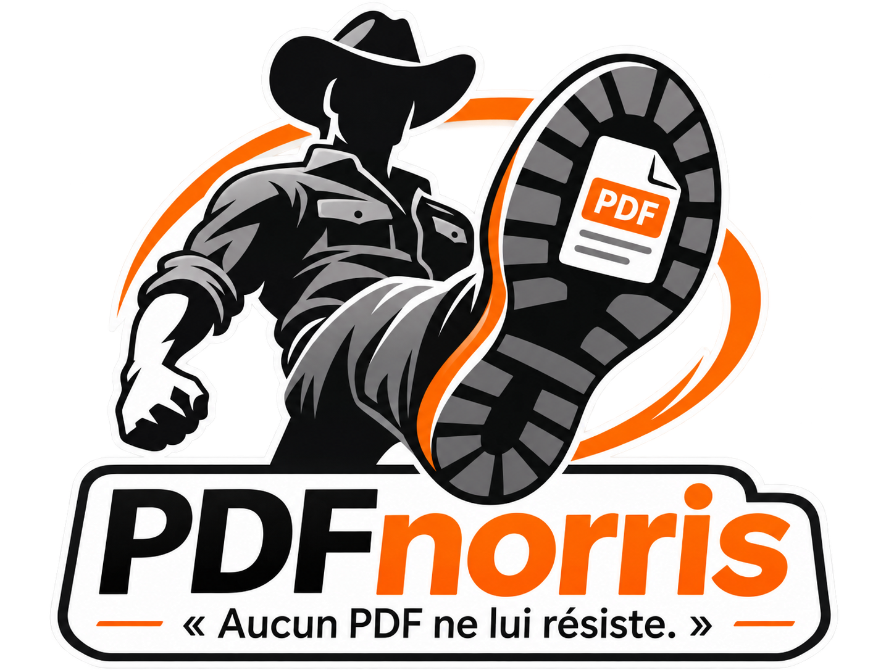
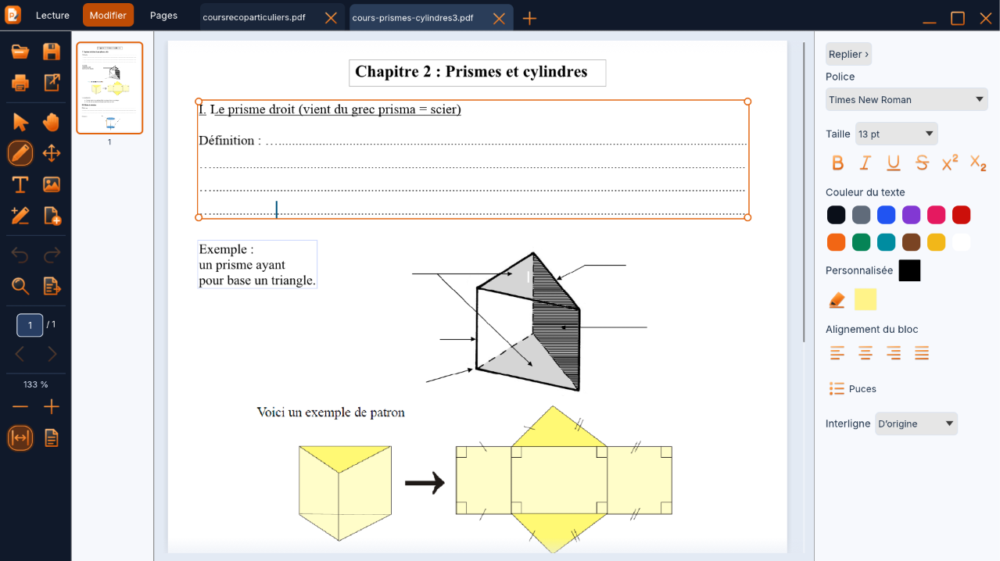
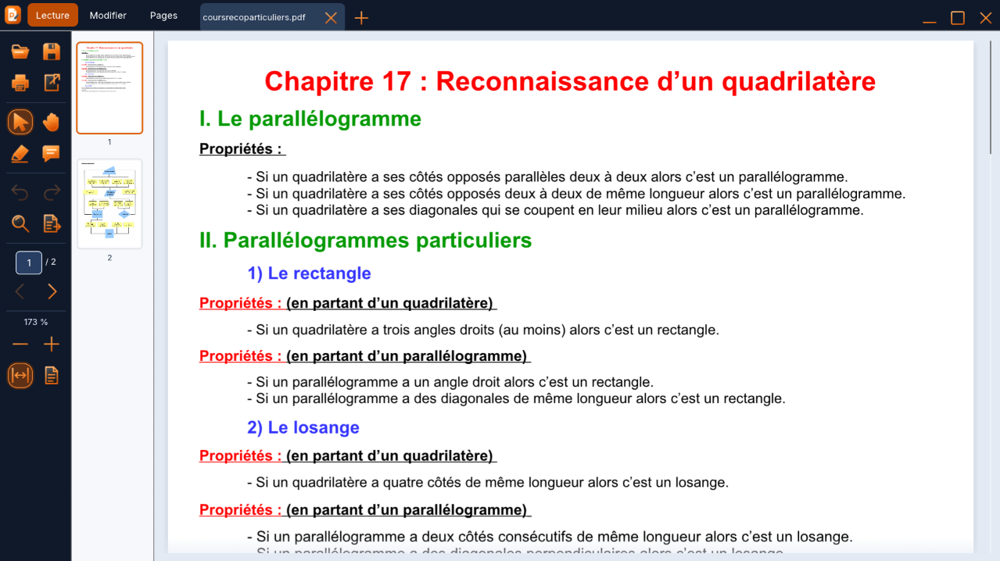
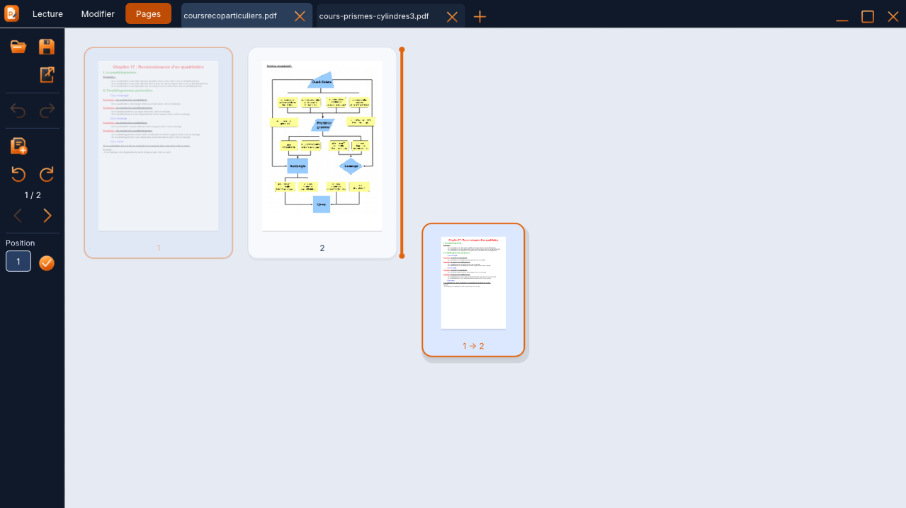
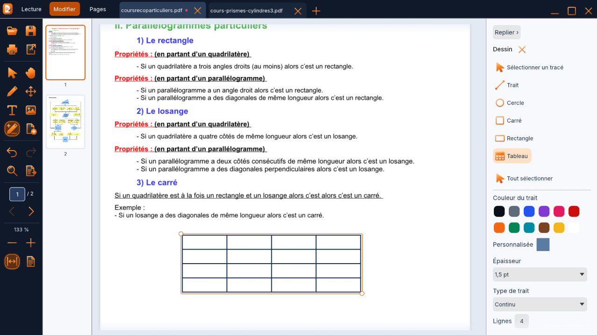
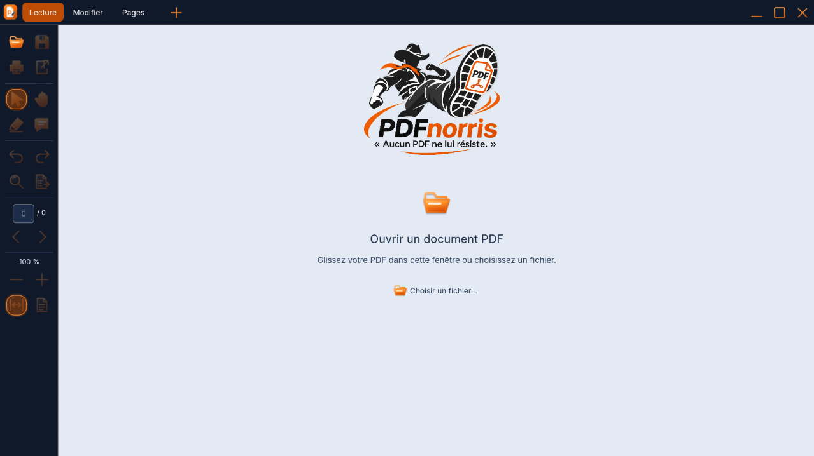

  

<h1 align="center">Vos PDF. À votre main.</h1>

  Corrigez une phrase. Annotez un cours. Remettez vos pages dans le bon ordre. 
  <strong>Un espace simple pour travailler sur vos PDF, directement sur votre PC.</strong>

  <strong>Gratuit</strong> &nbsp;·&nbsp; <strong>Local et hors ligne</strong> &nbsp;·&nbsp; <strong>Sans compte</strong> &nbsp;·&nbsp; Windows 10 / 11 x64

  
  &nbsp;
  

  <strong>V1.01</strong> &nbsp;·&nbsp;
  <a href="https://github.com/jossmair/PDFnorris/releases/tag/v1.01">Les nouveautés</a> &nbsp;·&nbsp;
  <a href="https://github.com/jossmair/PDFnorris/releases/download/v1.01/SHA256SUMS.txt">Empreintes SHA-256</a> &nbsp;·&nbsp;
  <a href="#bien-démarrer">Bien démarrer</a>

---

## Corrigez le document, directement sur la page

Sélectionnez un bloc, modifiez son texte et ajustez sa mise en forme dans le panneau de droite.
Police, taille, couleurs, alignement, puces et interligne : les réglages restent à portée de main.

Une vraie capture de PDFnorris V1.01. Cliquez sur les images pour les afficher en grand.

## Trois modes. Le bon outil au bon moment.

| **Lecture** | **Modifier** | **Pages** |
| :--- | :--- | :--- |
| Lire, rechercher, surligner et commenter. | Corriger un texte, ajouter une image, dessiner et compléter un tableau. | Assembler des PDF, réordonner, dupliquer, tourner ou extraire des pages. |

<table>
  <tr>
    <td width="50%">
      <strong>Lire et annoter</strong> 
      Le document au centre, les commandes à gauche.  
      
    </td>
    <td width="50%">
      <strong>Réorganiser d’un geste</strong> 
      Un aperçu de déplacement et un repère d’insertion visibles.  
      
    </td>
  </tr>
  <tr>
    <td width="50%">
      <strong>Dessiner et compléter</strong> 
      Traits, formes et tableaux ; couleur et épaisseur au choix.  
      
    </td>
    <td width="50%">
      <strong>Ouvrir et commencer</strong> 
      Glissez votre PDF dans la fenêtre ou choisissez un fichier.  
      
    </td>
  </tr>
</table>

## Et pour aller plus loin

| Votre besoin | Dans PDFnorris |
| :--- | :--- |
| **Retrouver le texte d’un scan** | OCR local pour transformer les zones reconnues en texte modifiable. Une relecture reste nécessaire. |
| **Reprendre le travail dans Word ou LibreOffice** | Export d’une copie en **DOCX ou ODT**. La fidélité dépend du PDF ; certaines formules complexes sont conservées comme images. |
| **Composer un document** | Insérez du texte en dessinant son cadre, ajoutez des images et utilisez le rognage par clic droit. |
| **Compléter un tableau dessiné** | Cliquez dans une cellule en mode Modifier ou Dessin pour saisir du texte. |
| **Travailler entre plusieurs PDF** | Plusieurs onglets, transfert de pages et copier-coller de blocs compatibles. |

[Gestion des pages](PAGES.md) · [Objets et schémas groupés](GROUPS.md) · [Validation et limites](VALIDATION.md)

## Bien démarrer

| **Sur votre PC** | **À emporter** |
| :--- | :--- |
| [Téléchargez l’installeur Windows](https://github.com/jossmair/PDFnorris/releases/download/v1.01/PDFnorris-1.0.1-Setup.exe), puis suivez l’assistant. | [Téléchargez le ZIP portable](https://github.com/jossmair/PDFnorris/releases/download/v1.01/PDFnorris-1.0.1-portable-exe-windows-x64.zip), puis extrayez-le entièrement. |
| Installation pour votre compte utilisateur. | Lancez **PDFnorris.exe** dans le dossier extrait et gardez **LICENCES.txt** à ses côtés. |

**Windows 10 / 11, 64 bits.** Aucun compte ni abonnement n’est nécessaire.
L’OCR utilise les langues compatibles installées dans Windows.

<strong>À savoir avant de télécharger</strong>

- Les exécutables ne sont pas signés Authenticode.
- L’édition dépend de la structure du PDF et des polices disponibles. Tous les objets ne se modifient pas de la même manière.
- L’OCR et les exports DOCX/ODT demandent une vérification : une copie parfaitement identique de tout PDF n’est pas garantie.
- La limite d’ouverture de cette version est de 256 Mio.
- Le traitement du clic molette a été repris dans la V1.01. Le test physique avec la souris à l’origine du signalement reste à confirmer.

[Notes de version](https://github.com/jossmair/PDFnorris/releases/tag/v1.01) · [Vérifications détaillées](VALIDATION.md)

## Ouvert aux retours. Ouvert aux contributions.

Un problème ou une idée d’amélioration ? [Ouvrez un signalement](https://github.com/jossmair/PDFnorris/issues).
Indiquez la version et les étapes à reproduire ; utilisez un exemple sans données personnelles.

Le code Rust, les tests et les ressources sont disponibles dans ce dépôt.

[Sources V1.01](https://github.com/jossmair/PDFnorris/tree/v1.01) · [Compiler le logiciel](BUILDING.md) · [Contribuer](CONTRIBUTING.md) · [Feuille de route](ROADMAP.md) · [Sécurité](SECURITY.md)

---

  <strong>Prêt à reprendre la main sur vos PDF ?</strong>  
  <a href="https://github.com/jossmair/PDFnorris/releases/latest"><strong>Télécharger PDFnorris V1.01 →</strong></a>

Un logiciel de la suite Ergonatus. Issu de <a href="https://github.com/jossmair/PDFinator">PDFinator</a>. Les licences et attributions des composants sont conservées dans les distributions.

